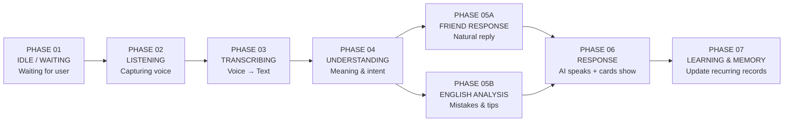

# Phase 1 — Voice Foundation (P0)

> **Priority:** P0 (Must-Have Foundation)  
> **Primary Layer:** Conversation Intelligence  
> **Deliverable:** A working two-way AI voice companion that listens naturally, transcribes accurately, responds conversationally, and handles interruptions without overlapping audio.

---

## 1. Complete 7-Phase Interaction Lifecycle

Every spoken turn moves through a decoupled, non-blocking lifecycle so the user never waits for a lengthy grammar analysis before the AI friend replies:



> **Key Architectural Decision:** Run **Phase 05A (Friend Response)** and **Phase 05B (English Analysis)** independently in parallel. The AI speaks its natural reply immediately while structured correction cards populate quietly on the side panel.

---

## 2. P0.1 — Natural Two-Way Voice Conversation

**Objective:** Allow users to speak freely with the AI without feeling like they are operating a robotic Q&A machine.

### A. Continuous Voice Conversation Requirements
- User clicks the microphone once to start a session.
- AI listens continuously while the user speaks.
- **Voice Activity Detection (VAD)** detects natural pauses vs. true end-of-turn silence.
- Converts completed speech into text, generates a natural friend reply, and synthesizes spoken audio (TTS).
- **Interruption Handling (Barge-In):** If the user starts speaking while the AI is talking, AI TTS stops cleanly with zero overlapping audio.
- Automatically returns to listening mode when the AI finishes speaking (when continuous conversation mode is enabled).

### B. Natural Conversation Behaviour
The AI friend must:
- Ask relevant, topic-grounded follow-up questions.
- Remember what the user just said within the session.
- Understand incomplete sentences when the intended meaning is clear.
- React warmly to tone without fabricating emotions it cannot actually detect.
- Avoid repeating the same canned questions or stiff textbook phrasing.
- Vary sentence structures and occasionally introduce engaging topics.

#### Example Exchange
- **AI Buddy:** *"Hey! How was your day? Did anything interesting happen?"*
- **You:** *"Actually, I went to university today. We had a very interesting lecture about artificial intelligence."*
- **AI Buddy:** *"Oh, that sounds interesting! Was it more about machine learning or how AI is changing the software development industry?"*

### C. Selectable Conversation Personalities
| Personality | Conversational Behaviour |
| :--- | :--- |
| **Friendly** | Casual, warm, supportive |
| **Curious** | Asks thoughtful, interesting follow-up questions |
| **Funny** | Uses light, appropriate humour |
| **Intellectual** | Discusses technology, science, and deeper ideas |
| **Calm** | Speaks slowly, gently, and patiently |
| **Motivational** | Encourages the user to keep speaking and expressing ideas |

> **Rule:** Changing personality adjusts conversational tone ONLY — it must **never** alter the accuracy or objectivity of language correction.

### D. Core Technical Components
- Clean single-stream audio capture (WebRTC / Web Audio API — zero Windows dual-mic APO contention).
- Voice Activity Detection (VAD) + silence threshold tuning.
- Speech-to-Text engine (`Whisper AI Local` / `Pure Live Solo STT` / `Gemini Audio`).
- LLM conversation responder.
- Text-to-Speech (TTS) audio output with immediate barge-in cancellation.
- Session & turn state manager.

### E. Phase 1.1 Acceptance Criteria
- [ ] User does not have to manually click "Submit" after every sentence in continuous mode.
- [ ] AI never talks over or responds while the user is still mid-sentence.
- [ ] User can interrupt AI voice playback cleanly at any time.
- [ ] Zero overlapping audio streams.
- [ ] Multi-turn conversation context is preserved accurately.
- [ ] Handles both brief replies (3–5 words) and extended turns (60+ seconds).

---

## 3. P0.2 — Accurate Speech Transcription

**Objective:** Produce faithful, punctuated transcripts so the grammar engine never blames the learner for speech-recognition mistakes.

### A. Live Transcription UX
Display real-time streaming feedback as the user speaks:
```text
Live transcript · Listening
"Yesterday I went to the university and..."   [● Voice detected]
```
Maintain strict separation between **interim** (live preview) and **final** (committed) transcripts. **Never run grammar analysis on incomplete interim speech.**

### B. Speech Recognition Requirements
- Accurately handles diverse global English accents, specifically including **Sri Lankan / South Asian English pronunciation**.
- Handles both slow, hesitant delivery and rapid fluent delivery.
- Preserves natural contractions (`I'm`, `don't`, `didn't`), fillers (`um`, `uh`, `actually`), repetitions, and self-corrections.
- Recognizes numbers, proper names, and technical vocabulary (e.g., *React*, *TypeScript*, *Colombo*).
- Preserves the user's original spoken words verbatim (never silently "auto-corrects" learner grammar inside the STT layer).

### C. Punctuation Restoration Subsystem
Treated as an explicit post-STT stage restoring sentence boundaries:
- Full stops (`.`), commas (`,`), question marks (`?`), exclamation marks (`!`), apostrophes (`'`), and sentence capitalization.

**Example:**
- **Raw speech:** `"I went to university yesterday it was really interesting did you know they introduced a new subject"`
- **Restored transcript:** `"I went to university yesterday. It was really interesting! Did you know they introduced a new subject?"`

### D. Separating Transcription Errors from Grammar Errors (Confidence Guard)
Example risk: User says *"I bought a new laptop"*, but STT outputs *"I bought new laptop."* Without confidence gating, the grammar analyzer would falsely accuse the user of missing an article.

| Transcription Condition | Required System Behaviour |
| :--- | :--- |
| **High-confidence transcript** | Send to grammar analyzer normally |
| **Low-confidence word** | Mark word as uncertain; do not trigger hard grammar penalty |
| **Ambiguous / clipped sentence** | Prompt user to confirm or quickly edit transcript |
| **Suspected STT homophone slip** | Flag as acoustic uncertainty, never penalize learner grammar |
| **User manually edits transcript** | Re-run grammar analysis on edited text while preserving immutable original raw STT log |

### E. Editable Transcript Requirement
- Every finalized user turn must be inline-editable if the mic misheard a word.
- Editing updates the analyzed transcript for accurate grammar feedback while keeping the original raw transcript immutable for QA and debugging.

### F. Phase 1.2 Acceptance Criteria
- [ ] Uncertain or low-confidence STT tokens are never automatically marked as confirmed grammar mistakes.
- [ ] Punctuation restoration correctly distinguishes statements (`.`), questions (`?`), and exclamations (`!`).
- [ ] User can edit a misheard word in 1 click and immediately re-verify grammar.
