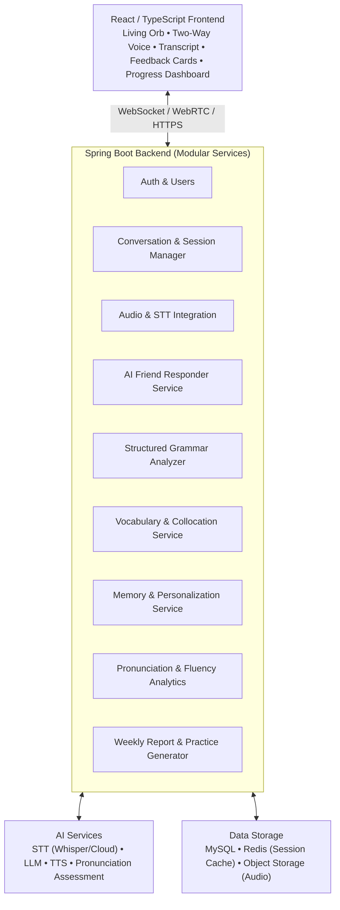

# Phase 5 — Living AI Orb, Full-Stack Architecture, Optimization & QA

> **Priority:** P0 UI Foundation (Orb) + Production Scale, Architecture & QA  
> **Deliverable:** A polished, alive, cross-device production experience powered by a 14-state voice-reactive Energy Orb, cleanly separated backend services, immutable learning records, and subsystem-level QA validation.

---

## 1. The Living AI Energy Orb — Complete State & Animation Specification

The Energy Orb is the visual identity of **AI Speaking Buddy**. Rather than looping a static spin, it acts as a **state-driven living character** whose shaders and motion reflect what the companion is doing in real time.

### Complete 14-State Behaviour Matrix

| # | State | Visual Behaviour | Meaning |
| :-: | :--- | :--- | :--- |
| 1 | **Idle** | Slow, calm internal energy drift | Ready and waiting for user |
| 2 | **Listening** | Expanding concentric sound rings | Actively capturing user's voice |
| 3 | **Transcribing** | Luminous particles flowing inward | Converting speech waveform to text |
| 4 | **Understanding** | Multiple synchronized orbiting rings | Processing meaning & context |
| 5 | **Thinking** | Fast-moving internal energy streams | Generating natural friend response |
| 6 | **Speaking** | Rhythmic pulsation synced to AI audio | AI friend voice playback active |
| 7 | **Happy** | Warm purple glow with gentle lift/bounce | Positive, friendly moment |
| 8 | **Encouraging** | Golden aura with sparkling particles | Motivating the user ("Try Again" win) |
| 9 | **Analyzing** | Subtle floating geometric rings/pulses | Background grammar check running |
| 10 | **Correcting** | Crisp cyan-green energy pulse | Presenting helpful correction card |
| 11 | **Deep Thinking** | Complex layered orbiting particles | Detailed grammar rule breakdown |
| 12 | **Confused** | Brief irregular wobble pulse | Unclear or clipped audio input |
| 13 | **Error** | Controlled red/orange brief flash | Technical / mic / network issue |
| 14 | **Sleeping** | Dimmed sphere with slow breathing | Session paused or muted |

### Voice Amplitude Reactivity
Connect `Web Audio API` (`AnalyserNode`) amplitude smoothly to orb scale/turbulence:
- **Quiet voice** $\rightarrow$ subtle ripple expansion.
- **Normal voice** $\rightarrow$ balanced dynamic waves.
- **Loud voice** $\rightarrow$ vibrant outward pulse.
- **Silence** $\rightarrow$ smooth exponential ease back to resting glow.

> **Guardrail:** Never interpret microphone loudness as emotional state or speaking confidence.

### Frontend Rendering Architecture
- **Engine:** `Three.js` / `React Three Fiber` with custom GLSL vertex/fragment shaders (or hardware-accelerated Canvas/WebGL fallback for low-power devices).
- **Zero-Jank Isolation:** Keep the animation loop (`requestAnimationFrame`) and audio amplitude refs **completely decoupled from React state re-renders** so streaming transcript updates never stutter the 60 FPS orb animation.

---

## 2. Recommended Full-Stack Modular Architecture

Structure the platform into independently testable and upgradable layers:

### Suggested Backend Modules (11 Services)
| Module | Core Responsibilities |
| :--- | :--- |
| `conversation` | Sessions, turn messages, and conversational context |
| `audio` | Audio streaming, VAD coordination, and clip storage |
| `transcription` | STT orchestration, confidence scoring, punctuation restoration |
| `grammar` | Structured mistake detection, categorization, and explanations |
| `vocabulary` | Basic-word upgrades, collocations, and user saved library |
| `memory` | Short-term, session, and long-term user memory + privacy controls |
| `mistakes` | Recurring mistake aggregation and normalized error rate calculation |
| `pronunciation` | Phoneme-level alignment and stress/sound scoring |
| `analytics` | Fluency metrics (WPM, pauses, fillers) and learning trends |
| `reports` | 7-day weekly English improvement report generation |
| `learning` | "Try Again" drills, targeted exercises, and personal knowledge base |

### Suggested Relational Database Schema (14 Tables)
| Table | Purpose |
| :--- | :--- |
| `users` | User profile, language preferences (`EN` / `EN+SI`), privacy settings |
| `conversation_sessions` | Session metadata (mode, personality, correction intensity, timestamps) |
| `conversation_messages` | Ordered user & AI turns with timestamps |
| `audio_transcripts` | **Immutable** raw STT transcript + separate user-edited transcript & word confidences |
| `grammar_corrections` | Individual detected mistakes linked to message & audio timestamp |
| `grammar_categories` | Taxonomy definitions (`VERB_TENSE`, `ARTICLES`, etc.) |
| `vocabulary_items` | Shared definitions, collocations, examples, Sinhala meanings |
| `user_vocabulary` | User's personal saved word bank & mastery status |
| `user_learning_memory` | Inspectable & deletable long-term preferences and interests |
| `recurring_mistakes` | Aggregated category counts, normalized error rates, and trend deltas |
| `pronunciation_results` | Phoneme/stress assessment scores per spoken clip |
| `fluency_metrics` | WPM, pause counts, hesitation ratios, and sentence lengths |
| `weekly_reports` | Generated 7-day learning summaries |
| `practice_attempts` | *"Try Again"* active spoken repetition results & success rates |

> **Critical Data Integrity Rule:** Always keep `original_raw_transcript` **immutable**. Store user edits and grammar corrections as separate linked records so STT accuracy and grammar precision can always be audited independently.

---

## 3. Subsystem Testing & Quality Assurance Matrix

Evaluate every subsystem independently rather than relying on informal chat checks:

| Subsystem | Key Evaluation Metrics |
| :--- | :--- |
| **Speech Recognition** | Word Error Rate (WER), Sri Lankan accent accuracy, punctuation F1 |
| **Conversation Engine** | Contextual relevance, follow-up naturalness, end-to-end latency |
| **Grammar Analyzer** | Precision (zero false alarms on valid English), recall, classification accuracy |
| **Explanations** | Grammatical soundness, clarity, Sinhala conceptual accuracy |
| **Vocabulary Engine** | Contextual fit and dialect fairness |
| **Memory Service** | Accurate recall + strict delete/opt-out privacy compliance |
| **Pronunciation Engine** | Phoneme-level correlation against reference audio |
| **Fluency Engine** | Reliable WPM, pause detection, and repetition counting |
| **Weekly Reports** | Mathematical correctness of normalized error rates & trends |

### 13 Essential Real-World Test Scenarios
1. User speaks with a natural **Sri Lankan English accent**.
2. User speaks very slowly with long thinking pauses.
3. User speaks rapidly with connected speech and contractions.
4. User pauses mid-sentence before completing a thought.
5. User changes direction halfway through a sentence (self-correction).
6. User uses frequent fillers (`um`, `uh`, `actually`, `like`).
7. User makes multiple distinct grammar mistakes in a single sentence.
8. User speaks **100% grammatically correct English** *(must produce 0 false errors)*.
9. User uses specialized technical or uncommon vocabulary.
10. User asks the AI mid-chat to explain an earlier mistake.
11. User interrupts the AI while it is speaking (barge-in test).
12. User switches abruptly between unrelated topics.
13. Moderate background noise affects microphone input.

> **Golden QA Test:** The system must **never** punish a user for an error introduced by its own speech recognition engine.

---

## 4. Final Prioritization Matrix

| Feature | Priority | Importance |
| :--- | :---: | :--- |
| Natural two-way voice conversation | **P0** | Essential |
| Accurate speech transcription + punctuation | **P0** | Essential |
| Living AI Energy Orb animations | **P0 UI** | Essential experience |
| Grammar correction after each turn | **P0** | Essential |
| Clear explanations (what was wrong & why) | **P0** | Essential |
| Gentle, Balanced & Detailed modes | **P1** | High |
| Vocabulary & natural-expression suggestions | **P1** | High |
| Conversation memory + privacy controls | **P1** | High |
| Recurring mistake tracking (normalized rate) | **P1** | High |
| *"Try Again"* active spoken practice | **P1** | High |
| Personal vocabulary & knowledge library | **P1** | High |
| Conversation topic generator | **P1** | High |
| Pronunciation analysis (audio-aligned) | **P2** | Advanced |
| Fluency analysis | **P2** | Advanced |
| Weekly progress reports | **P2** | Advanced |
| Sinhala (`සිංහල`) grammar explanations | **P2** | Advanced |
